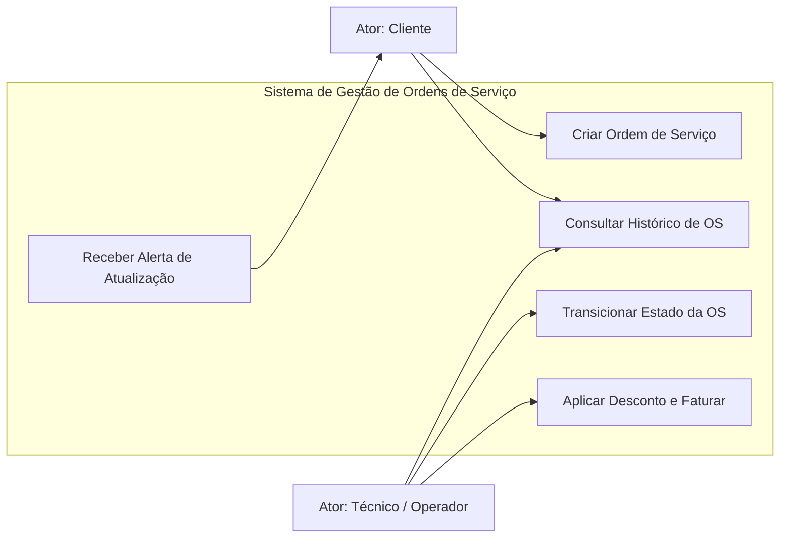
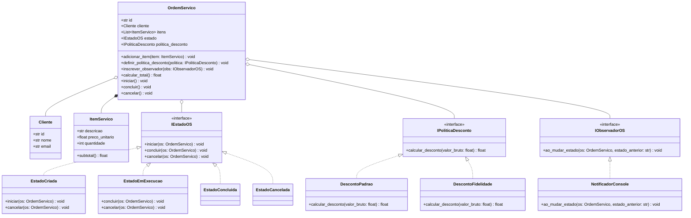
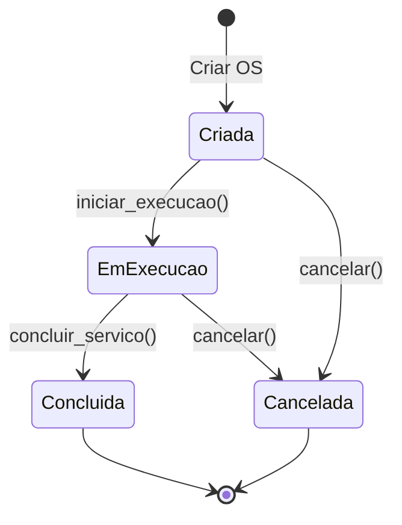
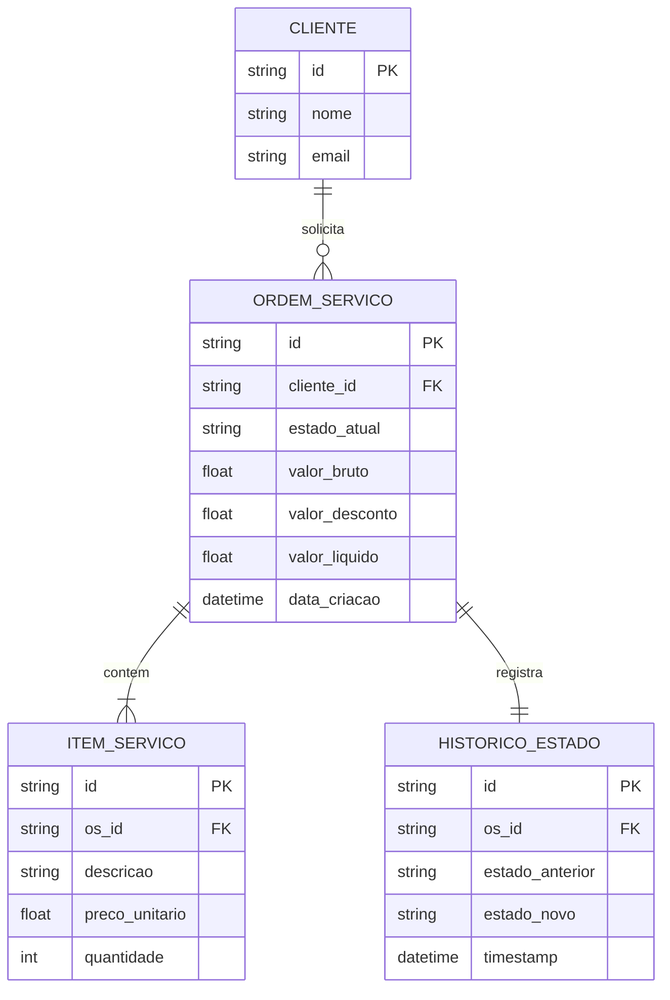

# Documento de Engenharia de Software: Sistema de Gestão de Ordens de Serviço (SGOS)

Este documento reflete a aplicação prática dos conceitos teóricos ensinados no curso de **Análise e Projeto de Software** (MEC / Aprenda Mais / IFRS).

---

## 1. Engenharia de Requisitos

### 1.1 Atores Identificados
- **Cliente**: Entidade externa que solicita e acompanha o status de ordens de serviço.
- **Técnico / Operador**: Entidade externa responsável pela execução, transição de estados e faturamento dos serviços prestados.

### 1.2 Requisitos Funcionais (RF)
- `RF01`: O sistema deve permitir a criação de uma nova Ordem de Serviço associada a um Cliente e itens/serviços.
- `RF02`: O sistema deve calcular o valor total com aplicação de políticas de desconto (Padrão Strategy).
- `RF03`: O sistema deve gerenciar a transição estrita de estados da OS (`Criada` -> `EmExecucao` -> `Concluida` ou `Cancelada`).
- `RF04`: O sistema deve emitir eventos/notificações quando o estado de uma OS for alterado (Padrão Observer).
- `RF05`: O sistema deve manter persistência dos dados e rastreabilidade por identificador único.

### 1.3 Requisitos Não Funcionais (RNF)
- `RNF01`: **Desacoplamento**: As classes de negócio não devem depender diretamente de detalhes de persistência ou interface de saída.
- `RNF02`: **Extensibilidade**: Novas regras de desconto ou canais de notificação devem ser adicionáveis sem modificar o código existente (Princípio Aberto/Fechado).

---

## 2. Diagramas de Engenharia de Software

### 2.1 Diagrama de Casos de Uso (UML - Visão do Usuário)

---

### 2.2 Diagrama de Classes (UML - Visão Estrutural)

---

### 2.3 Diagrama de Transição de Estados (DTE / State Machine)

---

### 2.4 Diagrama Entidade-Relacionamento (DER / Dicionário de Dados)

